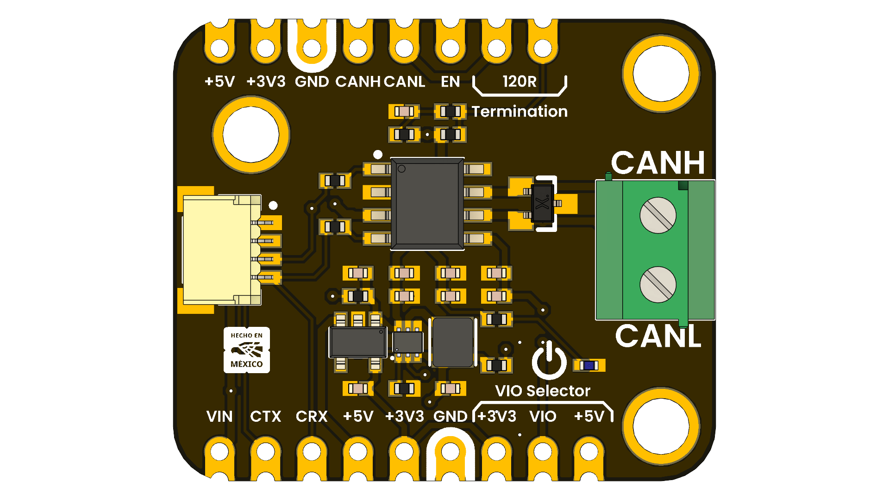

# DevLab: TCAN1051HVD CAN Transceiver Module

The TCAN1051HVD CAN Transceiver Module is a compact physical-layer interface between a CAN controller and a differential CAN bus. Built around the TCAN1051HVD, it supports Classic CAN and CAN FD physical-layer signaling at CAN FD data rates up to 2 Mbps, selectable 3.3 V or 5 V controller logic, onboard power regulation, CAN bus protection, and a 120 Ω termination network.

> **Note:** This module implements the CAN physical layer only. The host must provide a CAN controller or a microcontroller with an integrated CAN/TWAI peripheral.

> The ESP32-H2 and ESP32-P4 TWAI controllers used in the example support Classic CAN up to 1 Mbps, but not CAN FD frames. CAN FD operation requires a compatible CAN FD controller.

  
  
<em>TCAN1051HVD CAN Transceiver Module — UE0085</em>

### Quick Setup

## Overview

| Feature | Description |
|---|---|
| MPN | UE0085 |
| **Communication** | Classic CAN physical layer; CAN FD data rate up to 2 Mbps with a compatible controller. |
| **Input Voltage** | Module VIN range from 3.3 V to 5.0 V. |
| **Logic Voltage** | Selectable 3.3 V or 5 V controller-side logic through VIO. |
| **IC1 – TCAN1051HVD** | High-speed, fault-protected CAN transceiver with separate VIO supply. |
| **IC2 – AP2112K** | Onboard 3.3 V regulator. |
| **IC3 – TPS61023** | Onboard 5 V boost converter. |
| **D1 – CAN Protection** | PESD2CANFD24L-UX protection device on CANH and CANL. |
| **D2 – Power LED** | Onboard green power-status indicator. |
| **J1 – Controller Port** | 1 mm-pitch connector for GND, VIN, CTX, and CRX. |
| **J2 – CAN Bus Port** | 3.81 mm screw terminal for CANH and CANL. |
| **JP1 / JP2 / JP3** | Castellated connections for bus, logic, power, and control signals. |
| **JP4 / SB1 – VIO Selector** | Solder selector for 3.3 V or 5 V controller logic. |
| **CAN Termination** | Onboard 120 Ω CAN termination network. |

## Applications

- Industrial automation and distributed control
- Robotics and mobile platforms
- Building and environmental control
- Automotive prototyping and diagnostics
- CANopen, DeviceNet, NMEA 2000, ISOBUS, and other CAN-based networks

## Resources

- [Product Reference](docs/hardware/unit_product_reference_v_1_0_0_ue0085_tcan1051hvd_can_transceiver_module.pdf)
- [Hardware files and pinout](hardware/README.md)
- [Software examples](software/examples/README.md)

## 📝 License

This product and its documentation are licensed under the MIT License.  
See [`LICENSE`](LICENSE) for details.
